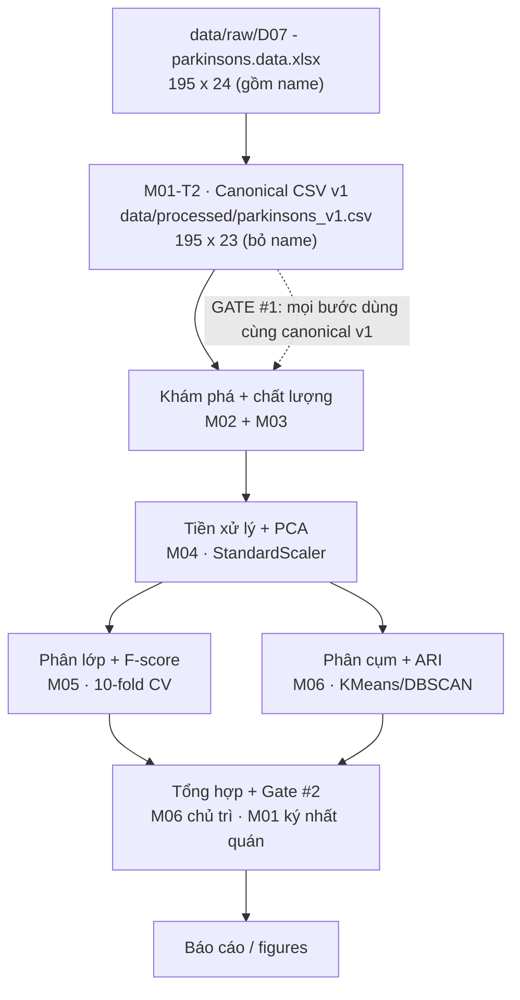
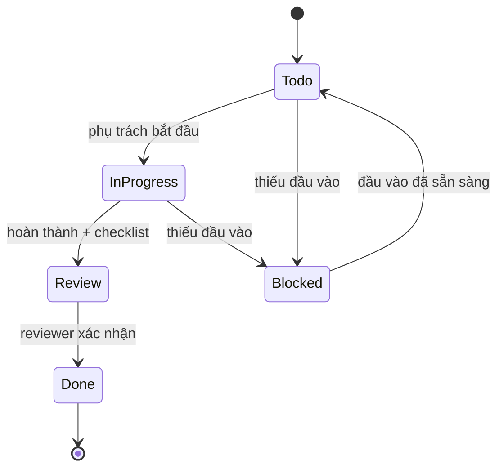
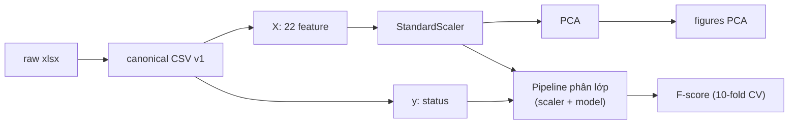
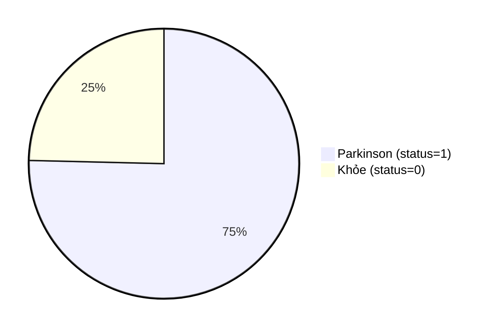
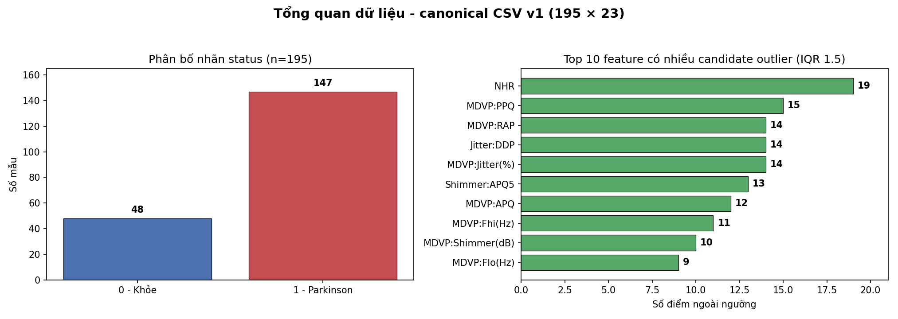
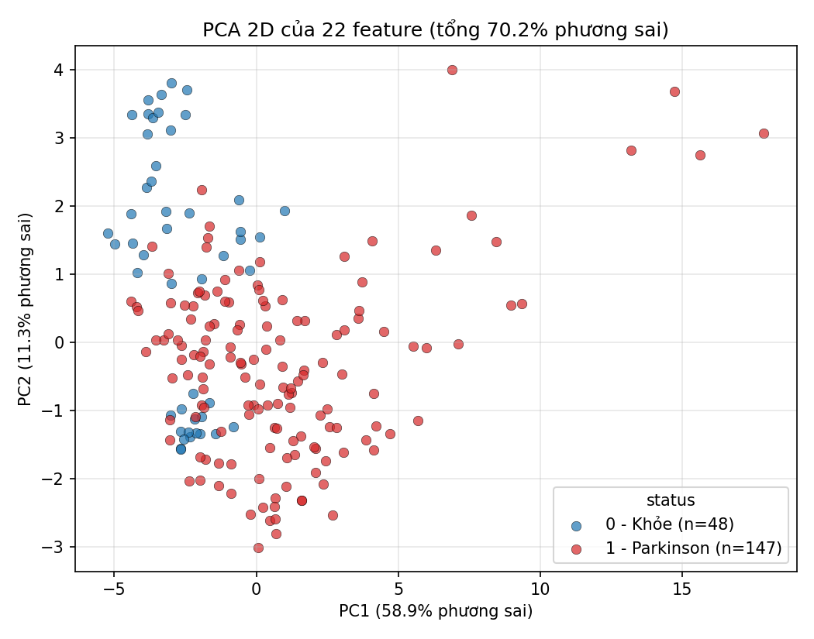
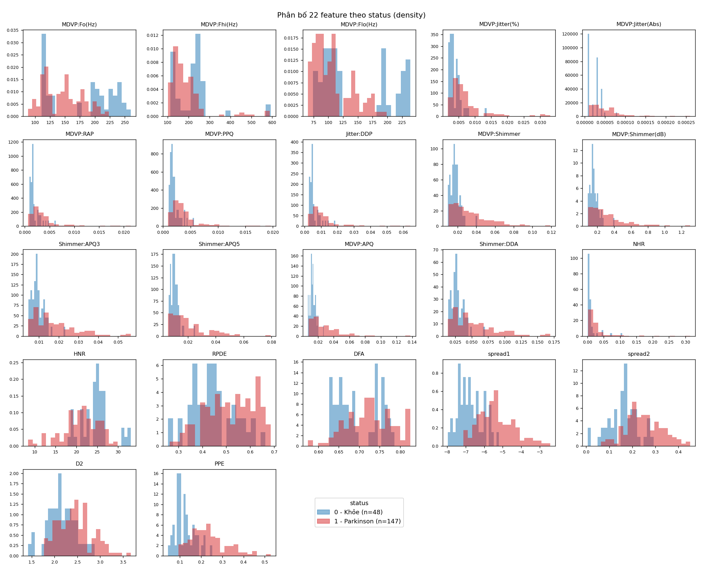
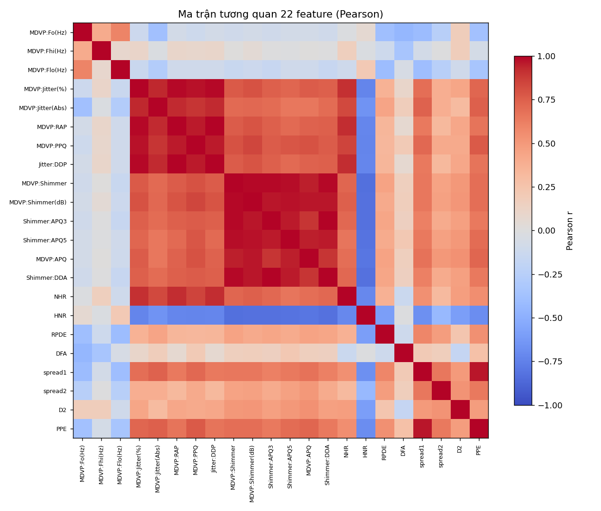
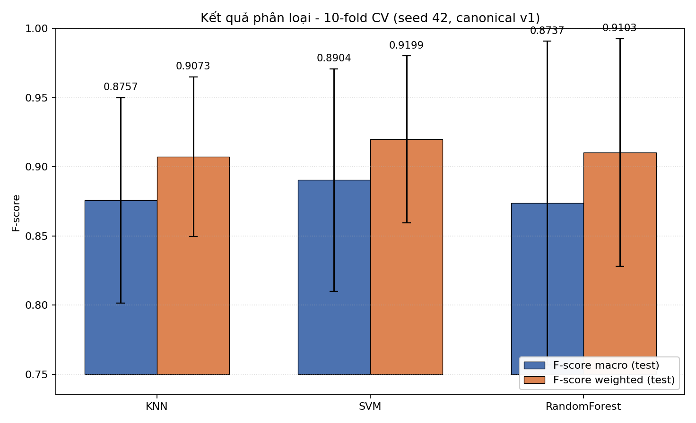

# Khai phá Dữ liệu — Oxford Parkinson's Disease Detection


> **Môn:** Khai phá dữ liệu · **Nhóm 3** · **Dataset:** Oxford Parkinson's Disease Detection (UCI, Max Little)
> **Repo:** [`KaiyoDev/Nhom_3_KhaiThacDuLieu_Parkinsons`](https://github.com/KaiyoDev/Nhom_3_KhaiThacDuLieu_Parkinsons)

Mục lục: [About](#-about) · [Pipeline](#-kiến-trúc--pipeline) · [Dữ liệu](#-dữ-liệu) · [Kết quả](#-kết-quả-thực-nghiệm) · [Cấu trúc](#-cấu-trúc-thư-mục) · [Cài đặt](#-cài-đặt--chạy) · [Tái lập](#-tái-lập-reproducibility) · [Trạng thái](#-trạng-thái--deadline) · [Team](#-đội-ngũ) · [Tham khảo](#-tài-liệu--tham-khảo)

---

## 📌 About

Dự án xây dựng quy trình **khai phá dữ liệu (data mining)** hoàn chỉnh trên tập dữ liệu giọng nói
của bệnh nhân Parkinson: từ chuẩn bị dữ liệu, khám phá, tiền xử lý, giảm chiều bằng PCA, tới
**phân lớp có giám sát** (đo bằng F-score) và **phân cụm không giám sát** (đo bằng ARI).

- **Bài toán:** phân loại `status` (`0` = khỏe, `1` = Parkinson) từ **22 đặc trưng giọng nói**
  (tần số, jitter, shimmer, noise, chỉ số phi tuyến).
- **Dữ liệu:** 195 bản ghi × 23 cột (22 feature + `status`), đã loại cột định danh `name`.
- **Mục tiêu kỹ thuật:** một đầu vào canonical duy nhất, pipeline tái lập được (cùng seed/phiên bản),
  đánh giá đúng chuẩn (CV stratified, chống data leakage), kết quả có hình ảnh/bảng minh hoạ.
- **Kết quả nổi bật:** PCA giải thích **70.2%** phương sai bằng 2 thành phần; phân lớp đạt
  **F-score macro 0.87–0.89** trên 10-fold CV với 3 mô hình (KNN, SVM, Random Forest).

Dự án do 6 thành viên phối hợp qua quy trình Git/PR rõ ràng (branch theo nhiệm vụ → PR → review → merge),
với 2 "cổng" đồng bộ: **GATE #1** (thống nhất canonical CSV) và **GATE #2** (nhất quán trước báo cáo).

---

## 🏗️ Kiến trúc & Pipeline



Luồng trạng thái của mỗi nhiệm vụ:



Luồng dữ liệu trong pipeline tổng hợp (`src/pipeline.py`):



---

## 📊 Dữ liệu

### Tổng quan (đã xác minh trên `data/processed/parkinsons_v1.csv`)

| Hạng mục | Giá trị |
|----------|---------|
| Số mẫu | **195** |
| Số cột canonical | **23** = 22 feature + `status` |
| Nhãn | `0` (khỏe): **48** · `1` (Parkinson): **147** |
| Missing / trùng lặp | **0** / **0** |
| Feature | FREQ (3) · JITTER (5) · SHIMMER (6) · NOISE (2) · NONLIN (6) |
| Cột đã loại | `name` (định danh chủ thể) |
| Chênh lệch scale | Có (FREQ hàng trăm, JITTER ~1e-4) → cần chuẩn hoá |



**Bằng chứng:** phân bố nhãn và các feature có nhiều candidate outlier (quy tắc IQR 1.5),
sinh từ chạy thật trên canonical v1.



> Ghi chú: header UCI ghi "197 instances" nhưng file thực tế có **195 dòng dữ liệu** — đã đối chiếu
> và ghi nhận trong `DATA_DICTIONARY.md`.

---

## 🧪 Kết quả thực nghiệm

### 1. Phân tích thành phần chính (PCA, M04)

| Chỉ số | Giá trị |
|--------|---------|
| PC1 | **58.9%** |
| PC2 | **11.3%** |
| PC1 + PC2 | **70.2%** |
| Số thành phần đạt ≥ 90% | **6** (tích lũy **91.61%**) |



Hai nhóm tách một phần, chồng lấp đáng kể trên PC1–PC2 — phù hợp với bài toán nhị phân có
nhiều đặc trưng âm thanh tương quan cao.

### 2. Phân bố & tương quan (M04)





- **14/22** feature lệch (`|skew| > 1`); **26/231** cặp feature có `|r| ≥ 0.9`.
- `Jitter:DDP ≈ 3 × MDVP:RAP` và `Shimmer:DDA ≈ 3 × Shimmer:APQ3` (r ≈ 1.0) — gần như trùng
  thông tin, được giữ nguyên trong canonical v1 và cần cân nhắc khi phân cụm.

### 3. Phân lớp (M05, 10-fold CV, seed 42)

| Mô hình | F-score macro (test) | F-score weighted (test) | F-score macro (train) |
|---------|:--------------------:|:-----------------------:|:---------------------:|
| KNN | 0.8757 ± 0.0742 | 0.9073 ± 0.0578 | 0.9647 |
| **SVM** | **0.8904 ± 0.0804** | **0.9199 ± 0.0603** | 0.9787 |
| Random Forest | 0.8737 ± 0.1171 | 0.9103 ± 0.0824 | 1.0000 |



- Chênh lệch giữa các mô hình (~0.016) **nhỏ hơn** độ lệch chuẩn giữa các fold (0.07–0.12) →
  không kết luận mô hình tốt nhất một cách quá chắc chắn; để reviewer/M06 cùng đánh giá.
- Random Forest có train F-score 1.0000 và std lớn nhất → dấu hiệu overfit.
- Nhận xét: điểm weighted cao hơn macro do lớp khỏe (48 mẫu) nhỏ hơn.

### 4. Phân cụm + ARI (M06)

⏳ Chưa hoàn thành (xem [Trạng thái](#-trạng-thái--deadline)).

---

## 🗂️ Cấu trúc thư mục

```text
Nhom_3_KhaiThacDuLieu_Parkinsons/
├── README.md                     # file này
├── TEAM.md                       # đội ngũ 6 thành viên
├── TASK_BOARD.md                 # trạng thái từng nhiệm vụ + deadline
├── TASK_ASSIGNMENTS.md           # phân rã 21 mã nhiệm vụ + phụ thuộc + reviewer
├── PROJECT_WORKFLOW.md           # luồng 6 giai đoạn + 2 gate
├── HANDOFF.md · CONTRIBUTING.md  # quy trình bàn giao & đóng góp
├── DATA_DICTIONARY.md            # mô tả 24 cột (đã xác minh)
├── docs/
│   ├── COLAB_GUIDE.md · GITHUB_GUIDE.md · TROUBLESHOOTING.md
│   ├── REPRODUCIBILITY.md        # quy ước seed/k/scaler/phiên bản
│   └── images/                   # hình minh hoạ trong README
├── data/
│   ├── raw/                      # dataset gốc (xlsx, đã commit)
│   ├── interim/                  # trung gian (không commit)
│   └── processed/                # canonical CSV v1 + schema
├── notebooks/                    # 5 notebook: 01 khám phá · 02 PCA · 03 phân lớp · 04 cụm · 05 tổng hợp
├── src/
│   ├── preprocessing.py          # nạp canonical, tách X/y, StandardScaler
│   └── pipeline.py               # pipeline tổng hợp (chạy được độc lập)
├── results/                      # F-score, ARI, báo cáo, figures/
├── reports/                      # báo cáo tổng hợp
└── workspaces/                   # work-order từng thành viên
```

---

## ⚙️ Cài đặt & chạy

### Môi trường

- **Python ≥ 3.10** (đã kiểm tra trên 3.14)
- `numpy`, `pandas`, `scipy`, `scikit-learn`, `matplotlib`, `seaborn`, `openpyxl`, `jupyter`
  (phiên bản tối thiểu trong `requirements.txt`)

```bash
git clone https://github.com/KaiyoDev/Nhom_3_KhaiThacDuLieu_Parkinsons.git
cd Nhom_3_KhaiThacDuLieu_Parkinsons
python -m venv .venv
source .venv/Scripts/activate      # Windows; trên Linux/macOS: source .venv/bin/activate
pip install -r requirements.txt
```

### Chạy pipeline tổng hợp

```bash
python -m src.pipeline
```

Đầu ra: `results/pipeline_summary.json` — chứa chỉ báo dữ liệu, PCA, F-score, tham số mỗi fold,
seed và phiên bản thư viện. Lệnh này **không đụng vào** các kết quả của notebook.

### Chạy notebook từng bước

```bash
jupyter lab notebooks/01_data_exploration.ipynb
jupyter lab notebooks/02_preprocessing_pca.ipynb
jupyter lab notebooks/03_classification.ipynb
```

### Google Colab

Mỗi thành viên dùng runtime riêng: upload `data/processed/parkinsons_v1.csv`, cài thêm
`openpyxl` nếu đọc xlsx, chạy từ notebook. Xem `docs/COLAB_GUIDE.md`.

---

## 🔁 Tái lập (reproducibility)

Mọi kết quả phải chạy lại được với cùng số. Quy ước chốt trong `docs/REPRODUCIBILITY.md`:

| Tham số | Giá trị |
|---------|---------|
| Seed | `42` |
| CV phân lớp | **k ngoài = 10**, **k trong = 5**, stratified theo `status` |
| Scaler | `StandardScaler` (fit trên train trong Pipeline; PCA/cụm fit trên toàn bộ X) |
| Chỉ số phân lớp | F-score **macro** (chính) + weighted (đối chiếu) |
| PCA | 2 thành phần để vẽ (70.2%); 6 thành phần nếu cần ≥ 90% |
| Anti-leakage | scaler fit trong fold train (Pipeline); chọn tham số bằng nested `GridSearchCV`; PCA/phân cụm fit trên toàn bộ X (không giám sát) |
| Dữ liệu | `data/processed/parkinsons_v1.csv` (version v1) — một đầu vào duy nhất |
| Phiên bản | `scikit-learn 1.9.0`, `pandas 3.0.x`, `numpy 2.4.x` |

Chạy `python -m src.pipeline` phải cho ra đúng các số ở mục [Kết quả](#-kết-quả-thực-nghiệm).

---

## 📋 Trạng thái & deadline

> **Deadline bài tập: 20/11/2026 (đã qua).** Bảng chi tiết: [`TASK_BOARD.md`](TASK_BOARD.md).

| Mã | Thành viên | Trạng thái | Bằng chứng |
|----|-----------|:----------:|------------|
| M01 | Đặng Hoàng Ân | 🟡 Đang điều phối | T1/T2 xong; gate S-T1 đang chốt |
| M02 | Lê Thiên Lộc | ✅ Hoàn thành | PR #5 đạt review & merge (19–22/11) |
| M03 | Huỳnh Gia Hợp | 🔴 Chưa hoàn thành — quá hạn 20/11 | Chưa có sản phẩm |
| M04 | Trần Hoàng Thông | ✅ Hoàn thành | PR #7 đã merge (17/11) |
| M05 | Ngô Thị Anh Thư | ✅ Hoàn thành | PR #8 đã merge (22/11) |
| M06 | Nguyễn Hoàng Bách | 🔴 Chưa hoàn thành — quá hạn 20/11 | Chưa có sản phẩm |

**Tiến độ:** 11/21 nhiệm vụ `Done` · 2 `In Progress` · 2 `Blocked` · 6 `Todo`.
Các PR đã xử lý: #5 (M02), #7 (M04), #8 (M05), #9 (cập nhật TASK_BOARD) — đều đã merge.

---

## 👥 Đội ngũ

| Mã | Tên | MSSV | Vai trò | Notebook |
|----|-----|------|---------|:--------:|
| M01 | Đặng Hoàng Ân | `080206014982` | Điều phối · dữ liệu · gate | (data prep, gate) |
| M02 | Lê Thiên Lộc | `079306040024` | Khám phá cấu trúc & dtype | 01 |
| M03 | Huỳnh Gia Hợp | `054205008367` | Thống kê mô tả · chất lượng | 01 |
| M04 | Trần Hoàng Thông | `075206008044` | Tiền xử lý · PCA · trực quan | 02 |
| M05 | Ngô Thị Anh Thư | `087306008195` | Phân lớp · CV · F-score | 03 |
| M06 | Nguyễn Hoàng Bách | `056205005522` | Phân cụm · ARI · tổng hợp | 04, 05 |

Nguồn: [`TEAM.md`](TEAM.md).

---

## 🤝 Quy ước đóng góp

- **Branch:** `task/<mã-member>-<mã-task>-<tên-ngắn>`; commit theo **Conventional Commits**.
- **PR:** bắt buộc trên `main` (branch protection `PR required`), gồm `Summary` · `Test Plan` · `Risk`.
- **Review:** mỗi nhiệm vụ có người review; chỉ `Done` khi đạt tiêu chí nghiệm thu.
- **Dữ liệu:** một canonical CSV duy nhất; không tạo bản CSV riêng; không commit bí mật/raw.
- Chi tiết: [`CONTRIBUTING.md`](CONTRIBUTING.md) · [`HANDOFF.md`](HANDOFF.md).

---

## 📚 Tài liệu & tham khảo

- **Dataset:** Max Little, University of Oxford — *Oxford Parkinson's Disease Detection Dataset*,
  UCI Machine Learning Repository. Ghi chú: mô tả UCI ghi 197 instances, file thực tế 195 dòng.
- **Bài báo liên quan:** Little, M. A., McSharry, P. E., Hunter, E. J., & Ramig, L. O. (2009).
  *Suitability of dysphonia measurements for telemonitoring of Parkinson's disease.*
  IEEE Transactions on Biomedical Engineering, 56(4), 1015–1023.
- **Tài liệu nội bộ:** [`DATA_DICTIONARY.md`](DATA_DICTIONARY.md) ·
  [`docs/REPRODUCIBILITY.md`](docs/REPRODUCIBILITY.md) ·
  [`PROJECT_WORKFLOW.md`](PROJECT_WORKFLOW.md) ·
  [`docs/COLAB_GUIDE.md`](docs/COLAB_GUIDE.md).

---

## 🛡️ Ghi chú an toàn

- Không commit token/mật khẩu/API key; `.env`, `*.key`, `secrets*` đã được `.gitignore` chặn.
- Cột `name` (định danh chủ thể) **loại bỏ** khỏi canonical CSV; chỉ giữ trong `data/raw/` nếu
  cần đối chiếu nội bộ.
- Mọi số liệu/figure trong README đều sinh từ chạy thật trên canonical v1; không điền sẵn số giả.
