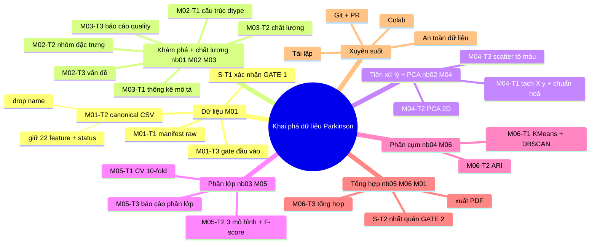

# Khai phá Dữ liệu — Dataset Parkinson (Nhóm 3)

> **Môn:** Khai phá dữ liệu · **Đề tài:** Oxford Parkinson's Disease Detection Dataset
> **Trạng thái:** ✅ Setup + 5 notebook khung + 6 work-order + roster đầy đủ — ⏳ chờ chạy phân tích.
> Repo GitHub: [`KaiyoDev/Nhom_3_KhaiThacDuLieu_Parkinsons`](https://github.com/KaiyoDev/Nhom_3_KhaiThacDuLieu_Parkinsons)

Đây là repo quản lý dự án nhóm 6: từ chuẩn bị dữ liệu → khám phá → tiền xử lý/PCA →
phân lớp (F-score) → phân cụm (ARI) → tổng hợp báo cáo. Mọi thứ ở đây là **khung + hướng dẫn**,
chưa có kết quả phân tích (sinh viên tự triển khai theo work-order).

---

## 1. Tổng quan đề tài

Xây dựng quy trình **khai phá dữ liệu (data mining)** trên tập dữ liệu giọng nói của bệnh nhân
Parkinson: dự đoán `status` (0 = khỏe, 1 = Parkinson) từ 22 đặc trưng âm thanh (jitter, shimmer,
noise, chỉ số phi tuyến…), kết hợp **phân lớp có giám sát** (F-score) và **phân cụm không giám
sát** (ARI) rồi tổng hợp thành báo cáo.

## 2. Mục tiêu

- Không gian làm việc **an toàn, nhất quán, tái tạo được** cho 6 thành viên làm việc độc lập.
- **Một nguồn dữ liệu xử lý duy nhất** (canonical CSV) — tránh mỗi người một bản CSV.
- **5 notebook khung** + **6 work-order** để từng người triển khai từng bước (không làm thay phần
  phân tích chính của sinh viên).
- Quy trình **Git/PR** rõ ràng để phối hợp 6 người.

## 3. Dữ liệu (đã xác minh từ file)

| Hạng mục | Giá trị |
|----------|---------|
| File gốc | `data/raw/D07 - parkinsons.data.xlsx` (dataset UCI, **đã commit** cho tiện dùng) |
| Sheet dữ liệu | `"parkinsons.data"` — **195 dòng × 24 cột** |
| Sheet mô tả | `"Descriptipion"` (mô tả UCI + citation) |
| Nhãn (target) | `status` — `0` khỏe, `1` Parkinson |
| Cột cần loại | `name` (tên chủ thể + số bản ghi) — drop trước khi phân tích |
| Feature (22) | FREQ(3) · JITTER(5) · SHIMMER(6) · NOISE(2) · NONLIN(6) |

Chi tiết từng cột: [`DATA_DICTIONARY.md`](DATA_DICTIONARY.md). Quy ước dữ liệu: [`data/README.md`](data/README.md).

## 4. Đội ngũ (6 thành viên)

| Mã | Tên | MSSV | GitHub | Vai trò | Notebook |
|----|-----|------|--------|---------|:--------:|
| M01 | Đặng Hoàng Ân | `080206014982` | `@KaiyoDev` | Điều phối + chuẩn bị dữ liệu + thống nhất đầu vào + gate | (data prep, gate 05) |
| M02 | Lê Thiên Lộc | `079306040024` | `@Phiadz` | Khám phá cấu trúc & kiểu dữ liệu | 01 |
| M03 | Huỳnh Gia Hợp | `054205008367` | `@HGiaHop` | Thống kê mô tả + kiểm tra chất lượng | 01 |
| M04 | Trần Hoàng Thông | `075206008044` | `@HoangThongTom` | Tiền xử lý + PCA + trực quan | 02 |
| M05 | Ngô Thị Anh Thư | `087306008195` | `@THUNGO-dot` | Phân lớp + cross-validation + F-score | 03 |
| M06 | Nguyễn Hoàng Bách | `056205005522` | `@nguyenhoangbach1` | Phân cụm + ARI + tổng hợp kết quả | 04, 05 |

Nguồn danh sách: [`TEAM.md`](TEAM.md).

## 5. Cấu trúc thư mục

```text
Nhom_3_KhaiThacDuLieu_Parkinsons/
├── README.md                # file này (toàn bộ dự án)
├── TEAM.md                  # danh sách 6 thành viên (tên + MSSV + GitHub + vai trò)
├── TASK_ASSIGNMENTS.md      # phân rã nhiệm vụ + phụ thuộc + người review
├── TASK_BOARD.md            # bảng trạng thái công việc (Todo/In Progress/Review/Blocked/Done)
├── PROJECT_WORKFLOW.md      # luồng tổng thể: chuẩn bị dữ liệu → báo cáo (6 giai đoạn + 2 gate)
├── HANDOFF.md               # quy trình bàn giao + cách báo cáo Blocked
├── CONTRIBUTING.md          # quy ước git/commit/review/conflict
├── DATA_DICTIONARY.md       # bảng mô tả thuộc tính (đã xác minh từ dataset)
├── requirements.txt         # numpy, pandas, scikit-learn, matplotlib, openpyxl, ...
├── .gitignore               # ignore nội dung data/, env, cache, bí mật; EXCEPTION: dataset gốc
├── data/
│   ├── raw/                 # dataset gốc (đã commit): D07 - parkinsons.data.xlsx
│   ├── interim/             # dữ liệu trung gian (gitignore, chỉ .gitkeep)
│   └── processed/           # canonical CSV sẽ được tạo ở M01-T2 (gitignore, chỉ .gitkeep)
├── workspaces/              # 6 work-order thành viên + mẫu "giao task"
│   └── member-01..06/README.md
├── notebooks/               # 5 notebook khung (skeleton, chưa code phân tích)
│   ├── 01_data_exploration.ipynb
│   ├── 02_preprocessing_pca.ipynb
│   ├── 03_classification.ipynb
│   ├── 04_clustering.ipynb
│   └── 05_integration_report.ipynb
├── src/  ·  tests/          # module + kiểm thử (tạo ở giai đoạn làm việc)
├── results/                 # kết quả thực nghiệm (F-score, ARI, figure)
├── reports/                 # báo cáo tổng hợp
└── docs/                    # COLAB · GITHUB · TROUBLESHOOTING · REPRODUCIBILITY
```

## 6. Pipeline (6 giai đoạn + 2 gate)

```text
G1 CHUẨN BỊ DỮ LIỆU (M01)  →  G2 ĐỒNG BỘ ĐẦU VÀO [GATE#1]  →  G3 KHÁM PHÁ + CHẤT LƯỢNG (M02+M03)
   →  G4 TIỀN XỬ LÝ + PCA (M04)  →  G5 MÔ HÌNH (M05 phân lớp | M06 phân cụm)  →  G6 TỔNG HỢP [GATE#2] (M06 chủ, M01 gate)
```

- **GATE #1 (S-T1):** toàn nhóm xác nhận **một canonical CSV duy nhất** trước khi chạy phân tích.
- **GATE #2 (S-T2):** nhất quán kết quả trước khi hoàn thiện báo cáo.
- Chi tiết: [`PROJECT_WORKFLOW.md`](PROJECT_WORKFLOW.md).

### Quy trình đầy đủ — sơ đồ tư duy (mind map)



> Bản văn tự đầy đủ: [`PROJECT_WORKFLOW.md`](PROJECT_WORKFLOW.md) + [`TASK_ASSIGNMENTS.md`](TASK_ASSIGNMENTS.md).

## 7. 5 Notebook

| Notebook | Phụ trách | Nội dung khung | Phụ thuộc |
|----------|-----------|----------------|-----------|
| `01_data_exploration.ipynb` | M02 + M03 | đọc dữ liệu, kích thước, dtype, thống kê, chất lượng | M01-T2 (canonical CSV) |
| `02_preprocessing_pca.ipynb` | M04 | tách X/y, chuẩn hoá, PCA 2D, scatter tô màu | M03 (chất lượng) |
| `03_classification.ipynb` | M05 | 10-fold CV, chọn 3/5 mô hình, F-score, tránh leakage | M04 (feature matrix) |
| `04_clustering.ipynb` | M06 | K-Means, DBSCAN, ARI (label chỉ dùng khi đánh giá) | M04 (feature matrix) |
| `05_integration_report.ipynb` | M06 (chủ) + M01 (gate) | tổng hợp 4 notebook + nhất quán + xuất PDF | kết quả 02/03/04 |

Mỗi notebook: markdown hướng dẫn + cell `TODO`, **chưa có code phân tích / kết quả / output**.

## 8. Hệ thống task & phối hợp

- **Phân công:** [`TASK_ASSIGNMENTS.md`](TASK_ASSIGNMENTS.md) (21 mã nhiệm vụ + phụ thuộc + reviewer).
- **Trạng thái:** [`TASK_BOARD.md`](TASK_BOARD.md) (5 trạng thái: Todo / In Progress / Review /
  Blocked / Done).
- **Work-order cá nhân:** `workspaces/member-XX/README.md` (nhiệm vụ + bước/cell + đầu vào/ra +
  tiêu chí + checklist + cách báo Blocked).
- **Bàn giao:** [`HANDOFF.md`](HANDOFF.md) (mô tả 5 dòng + test-report + quy tắc `Blocked`).
- Nguyên tắc: mỗi người chỉ làm phần được giao; thiếu đầu vào → đánh dấu `Blocked`; chỉ `Done`
  khi người review xác nhận đạt tiêu chí.

## 9. Tiến độ hiện tại (tiến độ dự án)

| Hạng mục | Trạng thái |
|----------|:----------:|
| Setup workspace + tài liệu quản lý | ✅ xong (đã commit) |
| Dataset trong repo (`data/raw/`) | ✅ xong (đã commit) |
| 5 notebook khung | ✅ xong (đã commit) |
| 6 work-order thành viên | ✅ xong (đã commit) |
| Roster đầy đủ (Tên + MSSV + GitHub, 6/6) | ✅ xong (đã merge qua PR #1) |
| Git/PR workflow (rule "PR required" bật) | ✅ cấu hình |
| **Canonical CSV (M01-T2)** | ⏳ **chưa — chưa ai chạy** (điểm mở khoá) |
| Phân tích (notebook 01–04) | ⏳ chưa (mọi nhiệm vụ `Todo`) |
| Kết quả F-score / ARI / báo cáo | ⏳ chưa |

**Tiến độ phân tích: 0/21 nhiệm vụ hoàn thành** (xem `TASK_BOARD.md`). Bước tiếp theo là
M01 tạo canonical CSV (M01-T2) để mở GATE #1 cho cả nhóm.

## 10. Git, PR & Colab

- **Branching:** `task/<mã-nhiệm-vụ>` → commit (Conventional Commits) → push → **PR** → review → merge.
- **Rule "PR required" đang BẬT trên `main`**: thành viên không push thẳng main, bắt buộc qua PR
  (owner có thể bypass). Xem [`docs/GITHUB_GUIDE.md`](docs/GITHUB_GUIDE.md).
- **Colab:** mỗi người một runtime độc lập, dataset upload riêng, thay đổi **không** tự đồng bộ
  với GitHub — phải commit. Xem [`docs/COLAB_GUIDE.md`](docs/COLAB_GUIDE.md).

## 11. Thư viện & công cụ (Python)

Danh sách **toàn bộ** thư viện công cụ dự án dùng, kèm nơi sử dụng. Phiên bản tối thiểu theo
`requirements.txt`; **Colab** đã cài sẵn nhóm lõi (numpy/pandas/scipy/scikit-learn/matplotlib) —
chỉ `openpyxl` thường phải cài thêm (xem `docs/COLAB_GUIDE.md`).

### Lõi xử lý dữ liệu
| Thư viện | Tối thiểu | Vai trò | Dùng ở |
|----------|:--------:|---------|--------|
| `numpy` | 1.26 | mảng số, tính vector | 01–05 (X, y, PCA, cluster) |
| `pandas` | 2.0 | DataFrame, đọc CSV/xlsx | 01 (đọc), M01 (tạo canonical CSV) |
| `scipy` | 1.10 | thống kê (skew, kurtosis) | 01 (thống kê mô tả) |
| `openpyxl` | 3.1 | đọc file `.xlsx` dataset gốc | M01-T1/T2 |

### Máy học — `scikit-learn` (≥1.3), dùng theo module
| Module (class) | Dùng ở | Việc |
|----------------|:------:|------|
| `preprocessing.StandardScaler` | 02, 03, 04 | chuẩn hoá |
| `decomposition.PCA` | 02 | giảm chiều (2D) |
| `model_selection` (StratifiedKFold, cross_validate, GridSearchCV) | 03 | 10-fold CV + tune |
| `neighbors.KNeighborsClassifier` | 03 | mô hình (1/5) |
| `ensemble.RandomForestClassifier`, `AdaBoostClassifier` | 03 | mô hình (2/5) |
| `naive_bayes.GaussianNB` | 03 | mô hình (3/5) |
| `svm.SVC` | 03 | mô hình (4/5) |
| `pipeline.Pipeline` | 03 | chống data-leakage |
| `cluster.KMeans`, `DBSCAN` | 04 | phân cụm |
| `metrics.silhouette_score`, `adjusted_rand_score` (ARI) | 04 | chọn K + đánh giá cụm |

> Notebook 03 **chọn đúng 3/5** mô hình (KNN, RF, NB, AdaBoost, SVM); phần còn lại là dự phòng.

### Trực quan hoá
| Thư viện | Tối thiểu | Dùng ở |
|----------|:--------:|--------|
| `matplotlib` | 3.7 | 02, 04 (scatter PC1–PC2, figure cụm) |
| `seaborn` | 0.13 | 01, 02 (heatmap tương quan, phân bố) |

### Notebook & xuất báo cáo
| Công cụ | Dùng để |
|---------|---------|
| `jupyter` / `jupyterlab` (≥1.0) | chạy 5 notebook (local) |
| `jupyter nbconvert` + `pandoc` | xuất PDF (checklist ở notebook 05) |

## 12. Tái lập (reproducibility)

Mọi kết quả phải chạy lại được: cùng canonical CSV (v1), cùng seed, cùng phiên bản thư viện
(và quy ước k-fold, loại F-score, K/eps — xem [`docs/REPRODUCIBILITY.md`](docs/REPRODUCIBILITY.md)
và `requirements.txt`).

## 13. An toàn dữ liệu

- Dữ liệu **bí mật / chưa được phép chia sẻ**: không đưa vào Git. Dataset Parkinson là UCI
  công khai nên **được commit** (cho tiện dùng); mọi xlsx khác vẫn bị `.gitignore` chặn.
- Không token / mật khẩu / API key. Tên + MSSV + GitHub đã điền (chỉ dùng khi được cung cấp, không bịa).

## 14. Bắt đầu (next steps)

1. **M01** chạy bước tạo canonical CSV (M01-T2) → mở GATE #1. 2. **M02+M03** chạy
   `01_data_exploration.ipynb`. 3. **M04** chạy `02_preprocessing_pca.ipynb`. 4. **M05**
   chạy `03_classification.ipynb`. 5. **M06** chạy `04_clustering.ipynb` rồi
   `05_integration_report.ipynb` (cùng M01 gate). Từng người làm theo work-order của mình
   (`workspaces/member-XX/README.md`).
