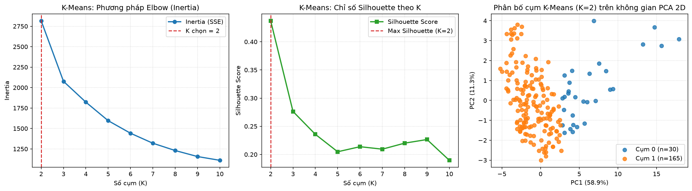
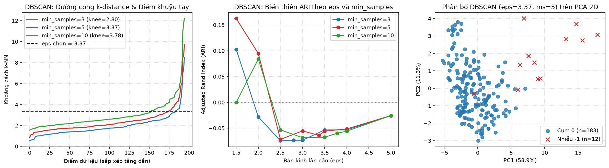

# Báo cáo M06: Phân cụm không giám sát (K-Means, DBSCAN) & Đánh giá đối chiếu nhãn (ARI)

- **Nhiệm vụ:** M06-T1 (Thực nghiệm K-Means & DBSCAN) & M06-T2 (Đánh giá ARI & Tổng hợp báo cáo)
- **Notebook thực thi:** `notebooks/04_clustering.ipynb`
- **Dữ liệu đầu vào:** `data/processed/parkinsons_v1.csv` (195 mẫu, 22 đặc trưng âm học, `random_state=42`)
- **Ngày chạy:** 2026-11-23
- **Phiên bản thư viện:** sklearn=1.9.1; pandas=3.1.1; numpy=2.5.5
- **Kết quả xuất (Artifacts):**
  - Bảng tổng hợp chỉ số: `results/m06_cluster_ari.csv`
  - Bảng khảo sát lưới DBSCAN: `results/m06_dbscan_grid.csv`
  - Biểu đồ trực quan: `results/figures/m06_kmeans_selection.png`, `results/figures/m06_dbscan_analysis.png`

---

## 1. Thiết lập thực nghiệm & Nguyên tắc chống rò rỉ nhãn

1. **Nguồn dữ liệu & Tiền xử lý:**
   - Sử dụng tập canonical `data/processed/parkinsons_v1.csv` từ nhiệm vụ M01-T2 (195 bản ghi, không có giá trị khuyết). Theo `schema_v1.md`, file canonical này **chưa được chuẩn hóa**; việc chuẩn hóa Z-score được thực hiện ngay trong notebook bằng `StandardScaler`, tham chiếu quy trình của M04-T1 (`src/preprocessing.py`, `results/m04_preprocessing_pca.md`).
   - Loại bỏ cột định danh `name` và tách riêng cột mục tiêu `status` (`1`: 147 mẫu Parkinson; `0`: 48 mẫu khỏe mạnh) ra khỏi ma trận đặc trưng $X \in \mathbb{R}^{195 \times 22}$.
   - Toàn bộ 22 đặc trưng được chuẩn hóa Z-score bằng `StandardScaler` ($\mu = 0, \sigma = 1$) trước khi phân cụm, thu được $X_s$.
2. **Bảo đảm tính không giám sát:**
   - Các mô hình `KMeans` và `DBSCAN` chỉ được huấn luyện (`fit`) trên ma trận đặc trưng chuẩn hóa $X_s$.
   - Nhãn thực tế `y = status` chỉ được dùng ở Bước 5 (đánh giá hậu kiểm) thông qua hàm `adjusted_rand_score(y, labels)`; notebook có `assert` bảo đảm `status` và `name` không nằm trong $X$.

---

## 2. Kết quả phân cụm K-Means ($K = 2 \dots 10$)

Thực nghiệm chạy `KMeans(n_clusters=k, random_state=42, n_init=10)` trên $X_s$, kết quả được sinh tự động tại `results/m06_cluster_ari.csv`:

| $K$ | Inertia | Silhouette | Kích thước cụm | ARI (so với `status`) | Lựa chọn |
| :---: | :---: | :---: | :---: | :---: | :---: |
| **2** | **2817.2** | **0.4373** | **[165, 30]** | **-0.0978** | **Silhouette cực đại** |
| 3 | 2076.2 | 0.2763 | [106, 77, 12] | 0.0582 | |
| 4 | 1822.4 | 0.2358 | [91, 77, 23, 4] | 0.0583 | |
| 5 | 1595.5 | 0.2048 | [73, 64, 32, 22, 4] | 0.1000 | |
| 6 | 1442.0 | 0.2138 | [60, 51, 30, 28, 22, 4] | 0.1058 | |
| 7 | 1319.8 | 0.2094 | [54, 51, 31, 24, 23, 8, 4] | 0.0882 | |
| 8 | 1230.5 | 0.2201 | [53, 35, 32, 23, 23, 15, 10, 4] | 0.0313 | |
| 9 | 1157.0 | 0.2265 | [52, 39, 25, 24, 21, 13, 9, 8, 4] | 0.0574 | |
| 10 | 1110.7 | 0.1896 | [38, 35, 26, 23, 22, 18, 12, 9, 8, 4] | 0.0481 | |

### Nhận xét K-Means
- **Lựa chọn số cụm:** K được chọn theo **Silhouette cực đại**, đạt tại $K = 2$ (`0.4373`) và giảm mạnh ở $K = 3$ (`0.2763`), sau đó dao động quanh `0.19–0.24`. Đường cong Elbow của Inertia giảm đều, không có điểm gập rõ ràng, nên Elbow chỉ dùng để đối chiếu chứ không quyết định K.
- **Đối chiếu nhãn thực tế (ARI):** ARI tại $K = 2$ là **`-0.0978`**, và trên toàn dải $K$ chỉ nằm trong `[-0.0978, 0.1058]` (cao nhất `0.1058` tại $K = 6$), đều xấp xỉ 0. Do đó cụm K-Means **không trùng khớp** với ranh giới bệnh lý `status`.
- **Bản chất của 2 cụm:** trên không gian PCA 2D (PC1 giải thích 58.9%, PC2 giải thích 11.3% phương sai), cụm nhỏ 30 mẫu nằm lệch về phía PC1 dương, còn 165 mẫu còn lại tập trung ở phần còn lại của không gian. K-Means đang tách một nhóm nhỏ có độ lệch lớn khỏi phần đông, chứ không tách nhóm khỏe mạnh khỏi nhóm Parkinson.

---

## 3. Kết quả phân cụm DBSCAN

1. **Ước lượng tham số $\varepsilon$ bằng phương pháp khuỷu tay (knee point):**
   - Với `min_samples = 5`, đường cong k-distance cho điểm khuỷu tay tại $\varepsilon_{\text{knee}} = 3.3741 \rightarrow \mathbf{3.37}$.
   - Chạy `DBSCAN(eps=3.37, min_samples=5)` trên $X_s$ thu được:
     - **Số cụm hình thành:** `1` cụm chính (gồm 183 điểm dữ liệu).
     - **Số điểm nhiễu (`label = -1`):** `12` điểm, nằm xa phần còn lại về phía PC1 lớn trên PCA 2D.
     - **Chỉ số ARI:** **`-0.0639`**.
2. **Khảo sát lưới tham số (`results/m06_dbscan_grid.csv`):**
   - Lưới gồm $\text{min\_samples} \in \{3, 5, 10\}$ và $\varepsilon \in \{1.5, 2.0, 2.5, 3.0, 3.5, 4.0, 5.0\}$ cùng giá trị $\varepsilon_{\text{knee}}$ của từng `min_samples`. ARI nằm trong khoảng **`[-0.0744, 0.1625]`**.
   - Giá trị cao nhất `0.1625` đạt tại $\varepsilon = 1.5$, `min_samples = 5`, nhưng khi đó có 149/195 điểm bị coi là nhiễu nên không có ý nghĩa phân cụm.
   - Khi $\varepsilon$ nhỏ, dữ liệu vỡ thành nhiều điểm nhiễu; khi $\varepsilon \ge 3.37$, hầu hết các điểm gộp vào một khối duy nhất. Điều này cho thấy trong không gian 22 chiều chuẩn hóa, mật độ điểm phân bố liên tục và không tách thành các vùng mật độ cao riêng biệt ứng với hai lớp bệnh/khỏe.

---

## 4. Kết luận & Đề xuất cho giai đoạn tiếp theo

- **Khả năng phân tách không giám sát:** cả K-Means (`ARI = -0.0978` tại $K=2$) và DBSCAN (`ARI = -0.0639` tại $\varepsilon=3.37$, $\text{min\_samples}=5$) đều có ARI xấp xỉ 0 hoặc âm. Ranh giới giữa người mắc Parkinson (`status=1`) và người khỏe mạnh (`status=0`) **không tách biệt theo cụm hình học hay mật độ** trong không gian 22 đặc trưng âm học.
- **Đề xuất:** sử dụng các mô hình **học có giám sát** (nhiệm vụ M05) hoặc trích chọn đặc trưng phi tuyến để khai thác thông tin nhãn `status` trong việc phân loại bệnh Parkinson.