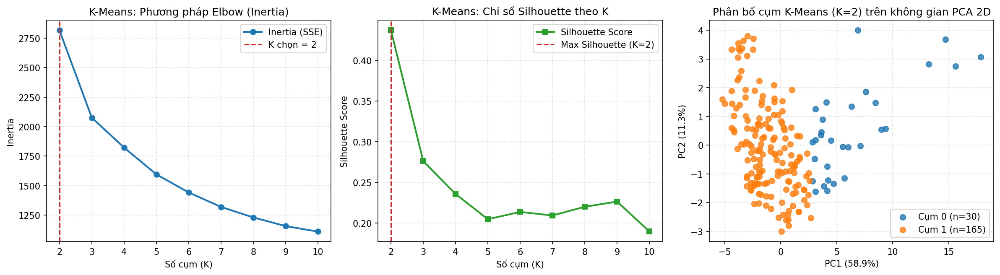
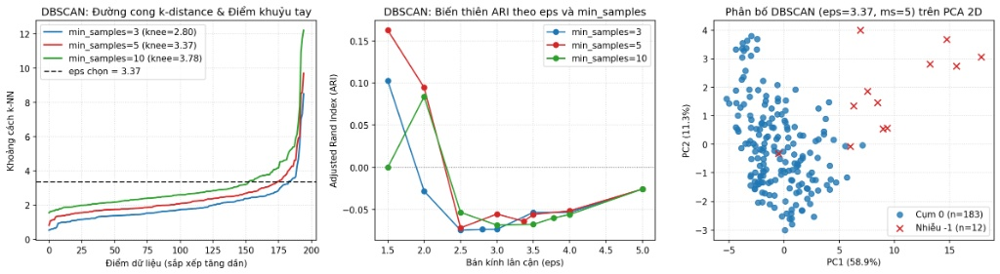

# Báo cáo M06: Phân cụm không giám sát (K-Means, DBSCAN) & Đánh giá đối chiếu nhãn (ARI)

- **Nhiệm vụ:** M06-T1 (Thực nghiệm K-Means & DBSCAN) & M06-T2 (Đánh giá ARI & Tổng hợp báo cáo)
- **Notebook thực thi:** `notebooks/04_clustering.ipynb`
- **Dữ liệu đầu vào:** `data/processed/parkinsons_v1.csv` (195 mẫu, 22 đặc trưng âm học, `random_state=42`)
- **Kết quả xuất (Artifacts):**
  - Bảng tổng hợp chỉ số: `results/m06_cluster_ari.csv`
  - Bảng khảo sát lưới DBSCAN: `results/m06_dbscan_grid.csv`
  - Biểu đồ trực quan: `results/figures/m06_kmeans_selection.png`, `results/figures/m06_dbscan_analysis.png`

---

## 1. Thiết lập thực nghiệm & Nguyên tắc chống rò rỉ nhãn

1. **Nguồn dữ liệu & Tiền xử lý:**
   - Sử dụng trực tiếp tập dữ liệu chuẩn hóa `data/processed/parkinsons_v1.csv` từ nhiệm vụ M01-T2 (195 bản ghi, không có giá trị khuyết). Tham chiếu quy trình chuẩn hóa đặc trưng và phân tích phương sai PCA từ nhiệm vụ M04-T1 (`src/preprocessing.py`, `results/m04_preprocessing_pca.md`).
   - Loại bỏ cột định danh `name` và tách riêng cột mục tiêu `status` (`1`: 147 mẫu Parkinson; `0`: 48 mẫu khỏe mạnh) ra khỏi ma trận đặc trưng $X \in \mathbb{R}^{195 \times 22}$.
   - Toàn bộ 22 đặc trưng được chuẩn hóa Z-score thông qua `StandardScaler` ($\mu = 0, \sigma = 1$) trước khi phân cụm.
2. **Bảo đảm tính không giám sát:**
   - Các mô hình `KMeans` và `DBSCAN` chỉ được huấn luyện (`fit`) trên ma trận đặc trưng chuẩn hóa $X_s$.
   - Nhãn thực tế `y = status` chỉ được dùng ở bước đánh giá hậu kiểm thông qua hàm `adjusted_rand_score(y, labels)`.

---

## 2. Kết quả phân cụm K-Means ($K = 2 \dots 10$)

Thực nghiệm chạy `KMeans(n_clusters=k, random_state=42, n_init=10)` trên $X_s$ thu được bảng kết quả chi tiết (được sinh tự động tại `results/m06_cluster_ari.csv`):

| $K$ | Inertia | Silhouette | Kích thước cụm | ARI (so với `status`) | Lựa chọn |
| :---: | :---: | :---: | :---: | :---: | :---: |
| **2** | **2817.2** | **0.4373** | **[165, 30]** | **-0.0978** | **Tối ưu nội tại** |
| 3 | 2076.2 | 0.2763 | [106, 77, 12] | 0.0582 | |
| 4 | 1822.4 | 0.2358 | [91, 77, 23, 4] | 0.0583 | |
| 5 | 1595.5 | 0.2048 | [73, 64, 32, 22, 4] | 0.1000 | |
| 6 | 1442.0 | 0.2138 | [60, 51, 30, 28, 22, 4] | 0.1058 | |
| 7 | 1319.8 | 0.2094 | [54, 51, 31, 24, 23, 8, 4] | 0.0882 | |
| 8 | 1230.5 | 0.2201 | [53, 35, 32, 23, 23, 15, 10, 4] | 0.0313 | |
| 9 | 1157.0 | 0.2265 | [52, 39, 25, 24, 21, 13, 9, 8, 4] | 0.0574 | |
| 10 | 1110.7 | 0.1896 | [38, 35, 26, 23, 22, 18, 12, 9, 8, 4] | 0.0481 | |

### Nhận xét K-Means:
- **Lựa chọn số cụm tối ưu:** Tại $K = 2$, chỉ số **Silhouette đạt cực đại (`0.4373`)** và giảm mạnh từ $K = 3$ trở đi (`0.2763` xuống `0.1896`). Đường cong Elbow trên Inertia cũng cho thấy điểm gập rõ rệt nhất tại $K = 2$.
- **Đối chiếu nhãn thực tế (ARI):** Mặc dù cấu trúc hình học nội tại chia dữ liệu tốt nhất thành 2 cụm `[165, 30]`, chỉ số **ARI tại $K=2$ chỉ đạt `-0.0978`** (và dao động thấp từ `-0.0978` đến `0.1058` trên toàn dải $K$). Điều này chứng tỏ 2 cụm tự nhiên trong không gian đặc trưng âm học **không trùng khớp** với ranh giới bệnh lý `status` (chủ yếu phân tách một nhóm nhỏ 30 mẫu có biến thiên biên độ/nhiễu loạn thanh quản lớn so với 165 mẫu còn lại).

---

## 3. Kết quả phân cụm DBSCAN

1. **Ước lượng tham số $\varepsilon$ bằng phương pháp khuỷu tay (Knee point):**
   - Với `min_samples = 5`, khoảng cách k-láng giềng gần nhất cho điểm gập tại $\varepsilon_{\text{knee}} = 3.3741 \rightarrow \mathbf{3.37}$.
   - Chạy `DBSCAN(eps=3.37, min_samples=5)` trên $X_s$ thu được:
     - **Số cụm hình thành:** `1` cụm chính (gồm 183 điểm dữ liệu).
     - **Số điểm nhiễu (`label = -1`):** `12` điểm.
     - **Chỉ số ARI:** **`-0.0639`**.
2. **Khảo sát lưới tham số mở rộng (`results/m06_dbscan_grid.csv`):**
   - Khảo sát trên tổ hợp $\text{min\_samples} \in \{3, 5, 10\}$ và $\varepsilon \in \{1.5, 2.0, 2.5, 3.0, \varepsilon_{\text{knee}}, 3.5, 4.0, 5.0\}$ cho thấy chỉ số **ARI nằm trong khoảng `[-0.0744, 0.1625]`**.
   - Trong không gian 22 chiều chuẩn hóa, mật độ điểm phân bố liên tục và không tách thành các vùng mật độ cao riêng biệt ứng với 2 lớp bệnh/khỏe; khi giảm $\varepsilon$ nhỏ dữ liệu bị vỡ thành nhiều điểm nhiễu, còn khi tăng $\varepsilon \ge 3.37$ hầu hết các điểm gộp chung vào một khối duy nhất.

---

## 4. Kết luận & Đề xuất cho giai đoạn tiếp theo

- **Khả năng phân tách không giám sát:** Cả K-Means (`ARI = -0.0978` tại $K=2$) và DBSCAN (`ARI = -0.0639` tại $\varepsilon=3.37, \text{min\_samples}=5$) đều cho thấy ranh giới giữa người mắc Parkinson (`status=1`) và người khỏe mạnh (`status=0`) **không tách biệt tuyến tính hay theo cụm mật độ thuần túy** trong không gian 22 đặc trưng gốc.
- **Đề xuất:** Cần sử dụng các mô hình **học có giám sát (Supervised Classification)** (nhiệm vụ M05) hoặc trích chọn đặc trưng phi tuyến để khai thác thông tin nhãn `status` trong việc phân loại bệnh Parkinson.
